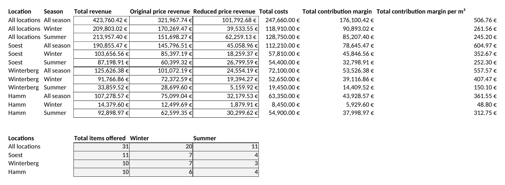
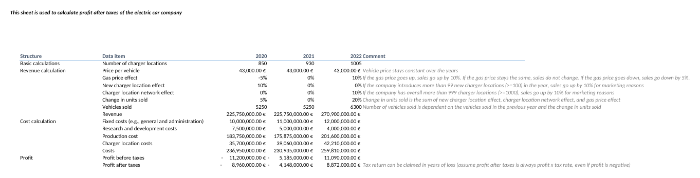
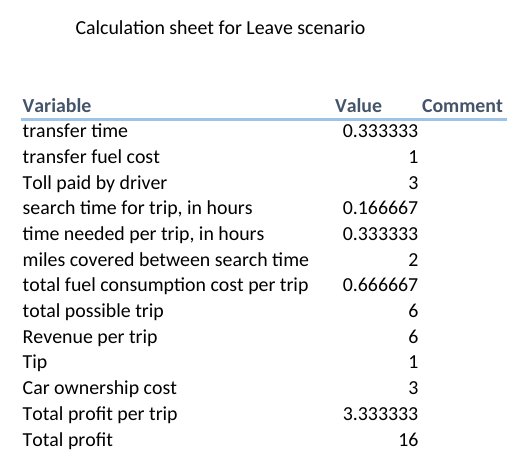

# Excel Business Modelling – Three Case Studies

**Three business cases solved in Excel: a sales analysis across three stores, a 3-year profit plan for an electric car maker, and a decision model for a taxi driver.**
Each workbook keeps inputs, assumptions, calculations and results on separate sheets, so every result updates when an input changes.

| # | Case | Business question | Main result |
|---|------|-------------------|-------------|
| 1 | [Sales analysis](#1-sales-analysis-by-store-and-season) | Which store and season earn the most? | Soest earns the most per m² (605 €), Hamm in winter the least (49 €) |
| 2 | [EV profit plan](#2-electric-car-company--3-year-profit-plan) | When does the company become profitable? | Loss in years 1–2, profit after tax of 8.9 m € in year 3 |
| 3 | [Taxi decision model](#3-new-york-taxi-driver--stay-or-leave) | Wait at the airport or drive in the city? | Both earn 16 USD in 2.33 hours, so the driver is indifferent |

---

## 1. Sales analysis by store and season
**Workbook:** [`workbooks/01_sales_analysis_by_store_and_season.xlsx`](workbooks/01_sales_analysis_by_store_and_season.xlsx)

**Question.** A sports retailer with stores in Soest, Winterberg and Hamm sells ski equipment (winter) and bikes (summer), at original and at reduced prices. Which locations and seasons generate the most revenue and contribution margin?

**Approach**
1. Transformed the raw sales list into a table in database format (one row per location, season and item) and added data validation for quantities and prices.
2. Added calculated columns: revenue at original and reduced price, price reduction in %, unit cost (VLOOKUP) and total cost.
3. Summarised revenue, cost and contribution margin by location and season with SUMIF, SUMIFS and COUNTIFS, and divided the margin by each store's sales area.

**Results**
- Total revenue **423,760 €**, of which **24 %** was sold at reduced prices. Contribution margin **176,100 €** (42 % of revenue).
- **Soest** earns the most: 190,855 € revenue and **605 € margin per m²**. Hamm earns only 362 € per m².
- **Hamm in winter** is the weak spot: 14,380 € revenue and 49 € margin per m², compared with 313 € per m² in summer.

## 2. Electric car company – 3-year profit plan
**Workbook:** [`workbooks/02_ev_company_3-year_profit_plan.xlsx`](workbooks/02_ev_company_3-year_profit_plan.xlsx)

**Question.** An electric car maker sells 5,000 cars today. How do sales, costs and profit after tax develop over the next three years, given changing fuel prices and a growing charging network?

**Approach.** Separate sheets for input data, constants and assumptions, and calculations. Nested IF formulas turn the business rules into sales effects: fuel price up → +10 %, down → −5 %; 100+ new charging locations → +10 %; a network of 1,000+ locations → +10 %. Units sold, revenue, four cost lines, profit before and after tax.

**Results**

| | Year 1 | Year 2 | Year 3 |
|---|---:|---:|---:|
| Vehicles sold | 5,250 | 5,250 | 6,300 |
| Revenue | 225.8 m € | 225.8 m € | 270.9 m € |
| Profit after tax | −9.0 m € | −4.1 m € | **+8.9 m €** |

The company becomes profitable in year 3, when sales grow by 20 % (rising fuel prices and a network of over 1,000 charging locations) while production cost per car falls from 35,000 € to 32,000 €.

## 3. New York taxi driver – stay or leave?
**Workbook:** [`workbooks/03_ny_taxi_stay_vs_leave_decision_model.xlsx`](workbooks/03_ny_taxi_stay_vs_leave_decision_model.xlsx)

**Question.** A taxi driver at LaGuardia Airport can wait in the queue for a long trip to Manhattan, or leave and pick up short trips in the city. Which earns more?

**Approach.** One input sheet and one calculation sheet per scenario: metered fare, tips (rounded with ROUND), fuel cost from city and highway consumption, the 50 % share for the cab company, tolls, and the time needed. The leave scenario counts how many short city trips fit into the time of the stay scenario.

**Result.** Both strategies earn **16 USD in 2.33 hours**, so the driver is indifferent. Because every value comes from the input sheet, other assumptions (queue time, trip length, fuel price) can be tested directly.

---

## Skills used
Data transformation and validation · SUMIF, SUMIFS, COUNTIF, COUNTIFS, SUMPRODUCT · VLOOKUP · nested IF and IFERROR · ROUND · absolute and mixed references · driver-based planning · scenario comparison · contribution margin analysis

## Background
Case studies from the module **Problem Solving Using Spreadsheet Software** (module grade 1.7) in my B.A. Business Administration with Informatics at **South Westphalia University of Applied Sciences (Fachhochschule Südwestfalen), Soest**, summer semester 2026.
The case descriptions and data were provided by the module. I completed the workbooks during the course, working through the cases step by step together with the lecturer.
